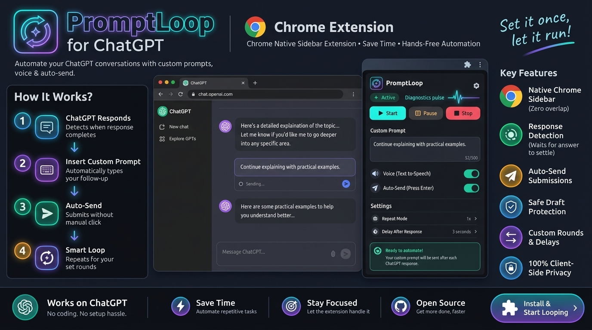

<p align="center">
  
</p>

<p align="center">
  
  
  
  
</p>

<h1 align="center">PromptLoop for ChatGPT</h1>

<p align="center">
  <strong>Automated follow-up prompting in Chrome's native Side Panel — hands-free conversation continuation.</strong>
</p>

---

## 🌟 Overview

**PromptLoop** is a lightweight, high-performance Chrome extension (Manifest V3) that docks into Google Chrome's native **Side Panel**. It automatically detects when ChatGPT completes an answer, counts down your configured delay, and submits your custom follow-up prompt without manual intervention.

Because it runs in Chrome's dedicated browser sidebar, your entire ChatGPT conversation stays 100% visible and unblocked.

<p align="center">
  
</p>

---

## ✨ Features

- **Chrome Native Side Panel**: Docks seamlessly alongside your ChatGPT window — no floating popups blocking your view.
- **Automated Follow-ups**: Configurable rounds and settle delays before submitting the next prompt.
- **Smart Completion Monitor**: Detects streaming state, stop-generating buttons, and response settlement before proceeding.
- **ProseMirror & React Resilient**: Bypasses modern ChatGPT placeholder traps with simulated keystrokes, clipboard fallbacks, and button synchronization.
- **Safe Draft Detection**: Skips auto-sending if you have an unsubmitted draft typed in the composer.
- **Self-Healing Connection**: Automatic script injection via `chrome.scripting` ensures the sidebar stays connected even after reloads.
- **Sleek Modern Dark UI**: Glassmorphic styling, pulse indicator, live countdown timer, and progress bar.

---

## 🚀 Installation

### Option 1: Download from GitHub Releases (Recommended)
1. Go to the [Releases](https://github.com/shaquib01/PromptLoop/releases) tab on the right.
2. Download `PromptLoop-v1.4.6.zip` and extract it to a folder on your computer.
3. Open `chrome://extensions` in Google Chrome.
4. Enable **Developer mode** (toggle in the top-right corner).
5. Click **Load unpacked** and select the extracted `PromptLoop` folder (the one containing `manifest.json`).

### Option 2: Clone via Git
```bash
git clone https://github.com/shaquib01/PromptLoop.git
```
Then load the folder via `chrome://extensions` using **Load unpacked**.

---

## 🎮 How to Use

1. Open [chatgpt.com](https://chatgpt.com/) in your browser.
2. Click the **PromptLoop** icon in your Chrome extensions toolbar — it will immediately open in Chrome's **Side Panel** on the right.
3. Set your custom prompt (e.g., `"Continue."`, `"Proceed with the next step."`).
4. Set your **Max follow-ups** (e.g., `3`) and **Wait after response** delay (e.g., `3 sec`).
5. Click **▶ Start**. PromptLoop will monitor ChatGPT's output and trigger the follow-up loops automatically!

---

## 🎛️ Controls & Settings

| Control | Description |
| :--- | :--- |
| **Start** | Begins automation and resets the follow-up round counter. |
| **Pause** | Pauses automation and preserves the current round count. |
| **Stop** | Halts automation immediately and resets the round counter to 0. |
| **Automation Enabled** | Master switch to toggle automatic looping on or off. |
| **Automatically Press Send** | When ON, automatically clicks Send. When OFF, inserts text for manual review. |
| **Max Follow-ups** | Upper limit of automated rounds before stopping (default: 3). |
| **Wait After Response** | Seconds of quiet time after streaming finishes before sending the prompt. |

---

## 🛡️ Privacy & Security

- **100% Client-Side**: PromptLoop runs purely in your local browser sandbox.
- **Zero Telemetry**: No user data, chats, API keys, or prompt content are ever tracked, logged, or sent to external servers.
- **Only Runs on ChatGPT**: Limited strictly to `chatgpt.com` and `chat.openai.com` via Manifest host permissions.

---

## ⚠️ Notes & Disclaimer

- PromptLoop interacts with the client-side DOM of ChatGPT and is **not** an official OpenAI integration. Changes to OpenAI's frontend structure may require extension updates.
- Always begin testing with a small limit (**Max follow-ups = 1 or 2**) before running extended loops.
- Do not use automated loops for sensitive, financial, or critical data modifications.

---

## 📄 License

This project is licensed under the MIT License.
